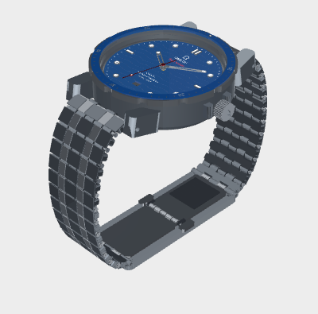
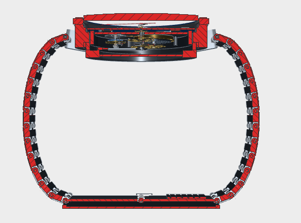

# Seamaster-inspired mechanical wristwatch

A detailed AAD assembly with a blue wave dial, metallic steel case and a bracelet closed around an assumed wrist. The model contains 613 named components, including its internal movement, nested hand drives, seals, threaded interfaces and articulated bracelet/clasp hardware.

**This is a custom Swiss-lever mechanism, not factory Omega calibre 8800 geometry or a validated operating watch.** The Omega Seamaster Diver 300M is the exterior reference. Dimensions, fits and material properties are design assumptions; the dial's certification and water-resistance lettering reproduce appearance only.



The preview uses metallic presentation settings. The generated viewer preserves the component colors and uses AAD's standard material and lighting defaults. Native **Material** and **Studio** controls remain available for presentation adjustments.

## Build and open

Run from the repository root with Python 3.12 and `uv`:

```sh
uv sync --locked --all-packages
uv run --locked --all-packages --with shapely==2.2.0 python fixtures/examples/seamaster/build.py
```

The full CAD build, checks, exports and tessellation take several minutes. Fonts can change inscription outlines and exported solid/triangle counts across operating systems; the original preview used Arial on macOS. All coordinates are in millimetres.

Open `.aad/examples/seamaster/viewer/standalone.html` in a WebGL-capable browser. It is offline and retains AAD's full native CAD panels. Its Views menu offers the movement, mainspring, balance and escapement, motion works/calendar, automatic winding, bracelet, clasp, longitudinal section and caseback. The default view hides the two sapphire components so the dial and movement can be inspected; the original glass geometry remains in the saved assembly and native part tree.

The script uses the canonical `aad_platform.viewer.bundle.export_bundle` without modifying its runtime or substituting a renderer. `viewer.html` is also generated for HTML hosts that inline its local assets; large scenes may exceed a host's inline size limit. Use `standalone.html` locally in that case; do not decimate the mesh to fit a chat limit.

Choose a different output location with `--output-dir PATH`. All outputs remain **draft**, including a build whose selected checks pass. A failed selected check returns a nonzero exit code after saving inspection outputs. `--allow-failed-checks` explicitly allows a zero exit status for unverified inspection; failures remain recorded. Kernel exceptions still fail the build.

This is an offline Python orchestration example: it intentionally writes exports and reports. It is **not** an I/O-free `model.py` payload for `aad_build`.

## Outputs

| File | Contents |
| --- | --- |
| `watch.step`, `watch.brep` | Exact assembly geometry in the closed wrist pose |
| `scene/` | Canonical saved AAD scene, with component colors and draft status |
| `viewer/standalone.html` | Self-contained CAD viewer; no server required |
| `views.json`, `presentation.json` | Inspection recipes resolved against the saved scene |
| `parts.csv`, `part_names.json`, `groups.json` | Component names and subsystem membership |
| `gears.json` | Tooth counts, modules, centers, axial planes and phases |
| `inspection.json` | Current run's selected geometry and motion observations |
| `export_check.json` | Validity, solid count and volume after reloading the BREP export |

Large generated CAD/scene/viewer files are built locally, not stored in Git. The default output directory is covered by the repository's `.aad/` ignore rule.

## What is modeled

- Nominal 42 mm scalloped bezel, 49.90 mm lug-to-lug envelope and 13.56 mm overall case height; the report separately measures the actual bezel X extent (the scallops reduce it slightly).
- Domed sapphire, ceramic insert, engraved wave dial, applied markers, skeleton hands and a 31-position calendar ring.
- Spline-defined 30° involute gear flanks with circular tip/root lands, a going train and central-seconds return, 12:1 motion works and a 24-hour calendar drive. These custom profiles are authored in this example to match its sampled analytical sweeps; they are not sourced Omega tooth geometry.
- A hollow mainspring barrel, removable lid, continuous 18-turn spring ribbon, hooks and bridle; balance rim, timing screws, roller ruby, pallet lever, escape wheel and continuous 10-turn hairspring.
- Jewel bearings, chatons, mainplate, bridges, dial feet and retaining hardware; manual winding/setting and automatic winding paths, reversal clicks, rotor races and balls.
- Crown and caseback helices with mating female relief; a pressed threaded caseback receiver, helium-valve components, coil springs and a 120-tooth bezel detent ring.
- Twenty-six bracelet structural links with interleaved bored knuckles, five-column finish faces, removable pins and retainers, telescopic spring bars, a hollow clasp, folding blades, buttons, hooks and an adjustment rack.



## What was checked

The committed [`reference/`](reference/) files record one local run, not a universal or independently certified pass. [`provenance.json`](reference/provenance.json) identifies its build-source hash, dependency versions, output hashes and scene ID; fonts and export timestamps prevent a cross-platform byte-reproducibility promise. Rebuilding writes fresh evidence under the output directory. The recorded run has valid source parts and a valid reloaded BREP, 475 sampled gear-pair positions, 72 small bracelet-joint rotations and 84 selected exact intersection checks without detected overlap. The exit-status check also rejects missing/non-finite evidence, mismatched gear centers and contact ratios below one.

The planar gear sweep uses sampled points from the same flanks used to interpolate the CAD splines. It is not a continuous, independent or loaded tooth-contact analysis. Exact intersections cover the listed pairs at the displayed pose: gear pairs, selected shafts/supports, hands, bracelet bodies, clasp and threaded interfaces. Small bracelet offsets are only −4°, 0° and +4° about that pose. Nominal hand-layer clearances are design inputs, labeled separately from measured geometry. The roughly 200 mm wrist assumption is not a user-specific sizing result.

These checks are **not** an exhaustive all-parts interference or full-range motion proof. Elastic seals, springs, fixed hubs and the nominal 0.005 mm radial receiver press fit can occupy contacting or preloaded regions intentionally. First-order balance/hairspring sizing uses CAD inertia and an assumed modulus; it does not prove timekeeping performance.

Escapement lock/drop/lift and unlocking, balance amplitude, winding face-gear contact, clutch slip and sliding engagement, calendar jump timing, reverser behavior, bridle friction, lubrication and full-range clasp kinematics remain unproven. No manufacturing tolerance stack, stress, fatigue, shock, rate, power-reserve, magnetic or water-pressure qualification is supplied.

References: [OMEGA exterior reference](https://www.omegawatches.com.hk/en-hk/watch-omega-seamaster-diver-300m-co-axial-master-chronometer-42-mm-21030422003001), [ETA technical communication used as an assembly-completeness reference](https://portal.eta.ch/fr/technicaldocuments/index/pdf/id/1883/). Neither provides this example's custom movement dimensions or validates its operation.
