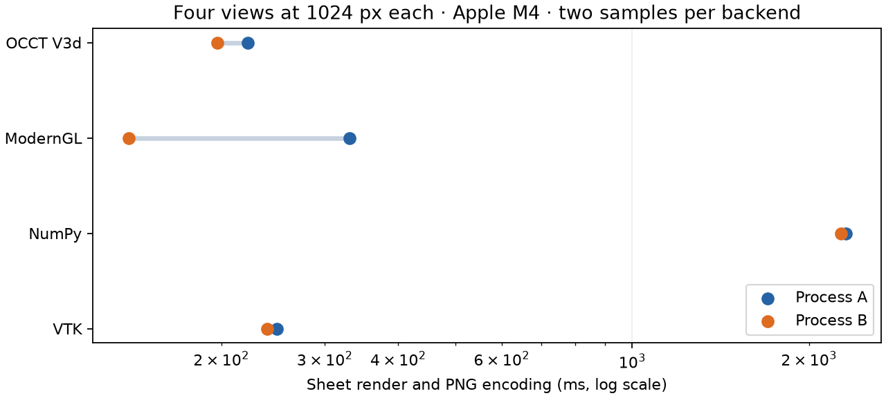
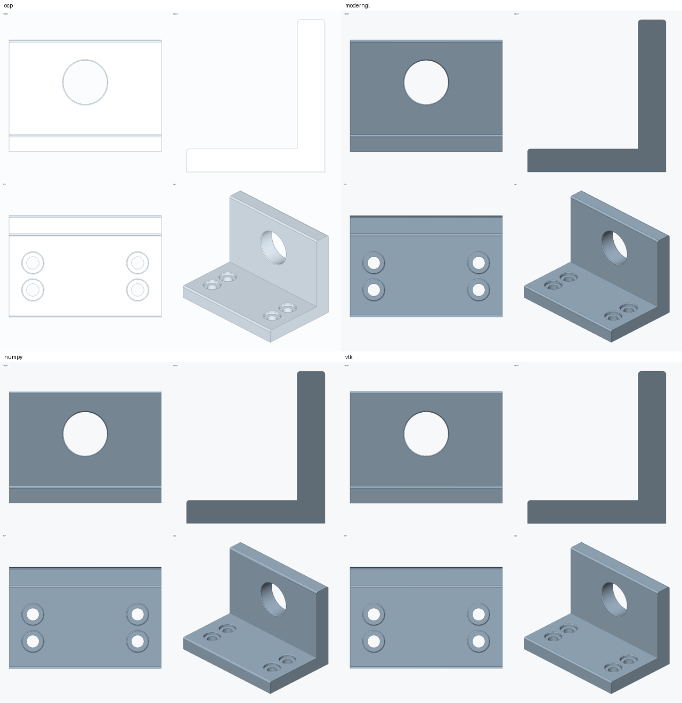

# Renderer experiment, 2026-11-04

Keep VTK as the current production backend. ModernGL is a promising replacement candidate:
it produced a matching-quality shaded bracket with much less installed code, and its second
sheet was faster in this small experiment. It is not a production replacement yet: these
prototypes only draw a shaded mesh and edges, and do not implement the full render request
surface (per-triangle heatmap colors, xray, highlights and section hatching). Linux headless,
other operating systems, resource cleanup under failures and complex models remain untested.

Measured on Apple M4 (10 GPU cores), macOS 26.6.2 arm64, Python 3.12.10. Each render ran in a
separate process; no other agent processes were controlled. The timed sheet is 2048 × 2048,
with four 1024 × 1024 panes, without supersampling. See [README.md](README.md) for reproduction
and timing boundaries, and [raw measurements](results/measurements.json) for hashes and versions.

| Backend | Probe import, ms | Sheet A, ms | Sheet B, ms | Same PNG across both processes | Installed backend files, MiB |
| --- | ---: | ---: | ---: | :---: | ---: |
| OCCT V3d | 674.90 | 221.86 | 196.90 | Yes | 0 extra* |
| ModernGL | 4.43 | 330.70 | 139.00 | Yes | 0.532** |
| NumPy software | 30.23 | 2307.40 | 2265.97 | Yes | 0 extra* |
| VTK | 274.88 | 248.50 | 239.31 | Yes | 515.913*** |

*OCCT, NumPy and Pillow are already part of the CAD/render environment. This does not mean
they take no disk space. The installed OCCT binding files are 221.842 MiB, NumPy 19.645 MiB,
and Pillow 11.413 MiB in this environment. The CPU rasterizer adds only the prototype source.

**ModernGL 5.13.0 plus glcontext 3.1.0: 557,513 bytes. Both packages report MIT licenses in
their installed metadata. Existing NumPy/Pillow and system OpenGL libraries are excluded.

***VTK 9.7.1 distribution files alone: 540,973,925 bytes. Additional dependencies such as
Matplotlib, the Python runtime, filesystem allocation and environment overhead are excluded.
These are logical installed file sizes from wheel RECORDs, not download sizes or clean-machine
installation totals. The benchmark environment contains all backends; no clean install was timed.

Probe imports follow `run.py`'s explicit module list and include different dependency imports;
they are diagnostic measurements, not interchangeable startup-cost estimates. The VTK probe
imports only the rendering modules used by this prototype, while production currently imports
the top-level package. Two sheet samples are insufficient to claim a stable speedup or variance.
An earlier local pair also gave identical image hashes; its timings are not the published dataset.

Visual review: all four outputs show the upright hole and the four stepped counterbores. V3d's
default lighting washes out the orthographic faces, making depth less legible; the isometric
view remains readable. ModernGL and the NumPy prototype closely follow the VTK reference's
lighting. The NumPy implementation is visibly coarser at silhouette/edge pixels and substantially
slower for this mesh. None of these images establish dimensional correctness beyond the common
kernel model and camera setup.

No production dependency or contract is changed by this experiment. The prototypes stay under
tests/perf and are not registered automatically. A future ModernGL integration should first
pass the same render tests as VTK and prove a headless context on supported systems.
